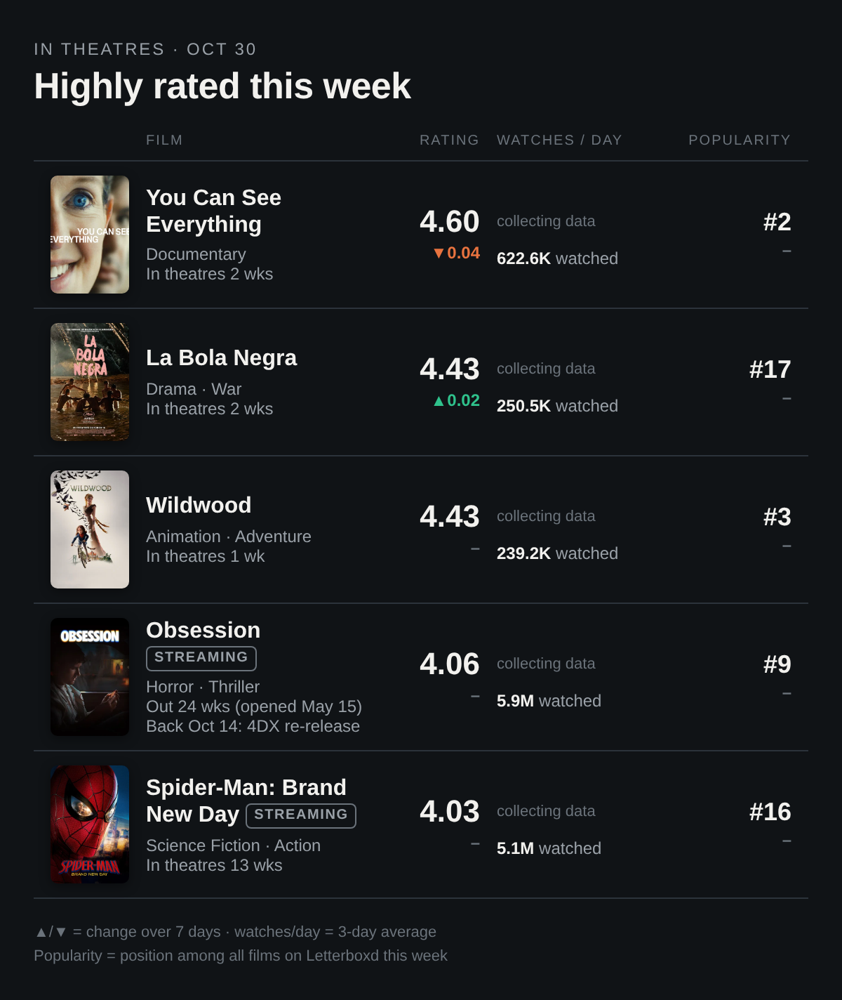

<p align="center"></p>

<h1 align="center">LetterBoxD Alerts</h1>

<p align="center">Find out when a film everyone loves on Letterboxd is still playing in a theatre near you.</p>

---

Letterboxd's popular list mixes new releases with classics and stuff that's been streaming for months. This little bot watches that list every day, keeps only the highly rated films that are **actually in US theatres right now**, and sends you a tidy digest on Telegram, so you never miss one on the big screen.

## What you get

A daily check, and a message whenever a film joins or leaves the list (plus a weekly roundup on Fridays):

<p align="center"></p>

Each film shows its rating and how it's trending, how many people are watching it each day, its spot on Letterboxd's popular list, and how long it's been in theatres. New arrivals get a **NEW** tag and films already out on digital get a **STREAMING** tag.

## Quick start

You'll need [uv](https://docs.astral.sh/uv/), a free [TMDB API token](https://www.themoviedb.org/settings/api), and a Telegram bot.

```bash
uv sync
uv run playwright install chromium   # renders the digest image
cp config.yaml.example config.yaml   # add your TMDB token and Telegram URL
```

Try it once, then leave it running:

```bash
uv run python scraper.py --once      # one check
./run.sh                             # check once a day, forever
```

The first run just saves a baseline quietly. Want to see a digest right away? Run `uv run python scraper.py --notify-latest`.

## Learn more

- [Configuration and running](docs/configuration.md): config options, command-line flags, and what happens on each run
- [The digest](docs/digest.md): what each column means and the data that's stored
- [How "in theatres" is decided](docs/theatre-filter.md): the TMDB release-date rules behind the filter
