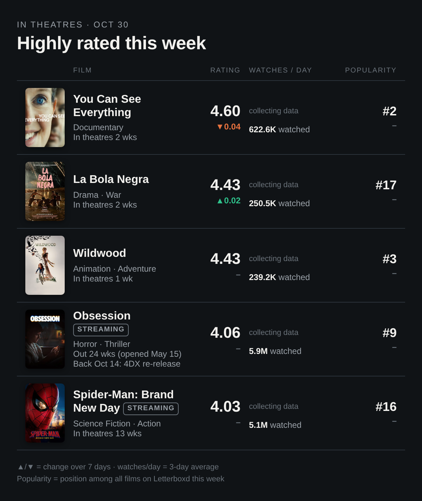

# The digest

Each notification is a single image (`logs/digest.png`), sent as a Telegram photo. It is built as an HTML page by `digest_image.py` and screenshotted with headless Chromium through Playwright.

The image is a leaderboard with one row per matching film:

- **Poster, title, genres**, and how long the film has been in theatres (or when it opens).
- **Rating**, with its change over the past 7 days.
- **Watches / day**: a 21-day sparkline of new Letterboxd watches per day, the recent 3-day average, and a momentum label (rising, steady or cooling, from comparing the last 3 days with the 3 before). Until there are two days of data this column shows "collecting data" and the lifetime watch count, as in the example above.
- **Popularity**: the film's position among all films on Letterboxd's popular-this-week list, its 7-day change, and a 21-day sparkline.

Films that just joined the list are highlighted with a NEW tag. Films that left appear greyed out under "Dropped off". If the image cannot be rendered (for example, Chromium is missing), the run sends a text digest instead of failing. Other Apprise targets get the text digest with the image attached.

## Stored data

Every run writes `logs/results_<date>_<time>.json`. These snapshots are the history behind the trends, so keep the directory; it is git-ignored and exists only on the machine running the job.

- `movies`: each matching film with its rating, popularity rank and lifetime Letterboxd watch, like and list counts (from the `/csi/film/<slug>/stats/` fragment) plus TMDB metadata. Watches per day is derived from consecutive watch counts.
- `candidates`: every film fetched from the popular-this-week list (top `candidate_limit`) with its rank and rating, including the ones the filters dropped.

Ratings go back to the first run. Ranks, watch counts and candidates are recorded from 2026-10-30 onward. Watches per day needs two days of data, and momentum needs about a week.
